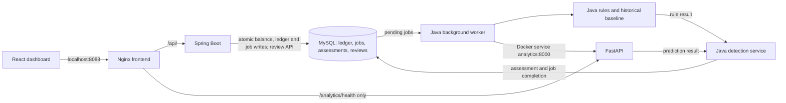

# FinGuard — Financial Transaction Anomaly Detection

A full-stack transaction monitoring workspace built with Java, Python and React.
FinGuard posts a consistent financial ledger, detects unusual activity with explainable
rules and Isolation Forest, and gives analysts an evidence-based investigation workflow.

**Current status — Milestone 6:** anomaly sensitivity investigated, broader synthetic
training data and chronological validation introduced, and native full-stack behavior
verified. This is a local educational/portfolio application; no public deployment
or cloud resources are configured.


## What it does

- Manage customers and accounts; post credits/debits and inspect paginated history.
- Keep balances exact with `BigDecimal` / `DECIMAL(19,2)`, transactions and row locks.
- Flag large amounts, bursts, possible duplicates and customer spending deviations.
- Combine rules with a Python Isolation Forest service, retaining rules during outages.
- Store detection evidence, model version, risk score, status and analyst review history.
- Monitor activity, volume and risk distribution in a responsive navy/white dashboard.
- Run locally using Compose with persistent MySQL data and file-mounted credentials.

Scores prioritize investigation on a 0–100 scale. **They are not calibrated fraud
probabilities.** Alerts do not automatically block or reverse valid transactions.

## Current model evaluation — Milestone 6

Reproducible synthetic evaluation, seed 42: **6,626 events**, split chronologically
into **3,975 training / 1,325 validation / 1,326 test** events. The test contains
123 labeled injections and 1,203 labeled benign events. Model fitting is unsupervised;
synthetic validation labels select the hybrid threshold policy. Test labels are
excluded from selection. Historical features use only earlier events.

| Detector on the same new held-out test | Precision | Recall | F1 | False-positive rate |
| --- | --- | --- | --- | --- |
| Frozen legacy hybrid | 20.12% | 83.74% | 32.44% | 34.00% |
| Current rules | 88.89% | 78.05% | 83.12% | 1.00% |
| Current Isolation Forest alone | 100.00% | 4.07% | 7.81% | 0.00% |
| Current hybrid | 88.89% | 78.05% | 83.12% | 1.00% |

The current hybrid has TP 96, FP 12, TN 1,191 and FN 27. Compared with the frozen
legacy hybrid, false positives decreased from 409 to 12, but seven additional
injections were missed. **ML added no detections beyond rules on this test**: its
five true positives were also caught by rules. These results describe synthetic
injections, not real fraud accuracy, and do not establish hybrid superiority.

The earlier 35/36 demo alert count reflected both deliberately rapid/duplicate seed
activity and a narrow original training distribution. Existing assessments and
investigation reviews are preserved; changing the model does not reset historical
alert rates. Risk scores remain investigation priorities, not fraud probabilities.

See [exact metrics and provenance](docs/evaluation-m6.json),
[investigation, reproduction commands and limitations](docs/ml-optimization.md),
and [interview talking points](docs/portfolio.md). The original Milestone 3 benchmark
is retained below under its own heading and uses a different dataset.

## Technology

| Layer | Stack |
| --- | --- |
| Ledger/API | Java 21, Spring Boot, Spring Data JPA, Bean Validation |
| Persistence | MySQL 8.4, Flyway migrations, exact decimal money |
| Analytics | Python 3.14, FastAPI, Pandas, NumPy, Scikit-learn Isolation Forest |
| Dashboard | React, Vite, JavaScript, Tailwind CSS, Recharts, Lucide |
| Local packaging | Multi-stage Docker builds, Nginx reverse proxy, Docker Compose |
| Verification | JUnit/Spring tests, pytest, Vitest/Testing Library, Playwright, smoke checks |

## Choose a local setup

| Setup | Dashboard | Verification status |
| --- | --- | --- |
| Native development: MySQL + Spring Boot + FastAPI + Vite | `http://127.0.0.1:5173` | Native services, full-stack smoke checks and browser flows verified |
| Docker Compose: MySQL + Spring Boot + FastAPI + Nginx frontend | `http://localhost:8088` | Configuration/static checks completed; Docker execution not verified |

### Native development (verified path)

Use Java 21, MySQL 8.4, Python 3.14 and Node.js 22.12+. Follow the
[native setup guide](docs/native-setup.md), [analytics guide](ml-service/README.md)
and [frontend guide](frontend/README.md):

1. Configure a local MySQL database and private environment credentials. Let Flyway
   apply migrations; do not import the reference schema into an initialized database.
2. Install the pinned Python dependencies, train the trusted local model with
   `python -m analytics.train --seed 42 --output artifacts` from `ml-service`, and
   start FastAPI on loopback port 8000.
3. Start Spring Boot with the documented `DB_*` and `ML_BASE_URL` configuration on
   port 8080; confirm `/api/health` returns `UP`.
4. In `frontend`, run `npm ci`, configure `VITE_API_BASE_URL` for
   `http://127.0.0.1:8080/api`, then run `npm run dev`. Match the allowed local CORS
   origin to the frontend URL.
5. Open [http://127.0.0.1:5173](http://127.0.0.1:5173). Stop foreground servers with
   Ctrl+C and stop MySQL using its normal service controls. Keep database storage
   and private configuration for the next session.

Native MySQL ports can be configured through `DB_URL`. Do not run write tests or
reset commands against an existing manual-demo database.

### Docker Compose (configured, execution not verified)

Prerequisites: Docker Engine/Desktop with Compose v2 (Linux containers), plus Python
3.10+ for the small environment-setup helper. Python 3.14 is used for native ML work.
Allow several minutes for the first image build: dependencies, Java/frontend tests,
Python tests and reproducible model training happen inside the build stages.

```powershell
git clone https://github.com/rohanshettym1-cmd/FinGuard-Financial-Anomaly-Detection.git
cd FinGuard-Financial-Anomaly-Detection
python scripts/setup_env.py --demo
docker compose config --quiet
docker compose up --build -d --wait --wait-timeout 240
```

Open **[http://localhost:8088](http://localhost:8088)**. Change `WEB_PORT` in the ignored
root `.env` if needed. Only the frontend is published, bound to loopback; MySQL,
Spring Boot and FastAPI communicate through Docker's private service network.

`setup_env.py` copies `.env.example` into an ignored `.env` and generates two random
password files in ignored `.secrets/`. It never prints passwords or overwrites an
existing environment/secret. Compose mounts the application password into MySQL and
Spring's config tree; the root password goes only to MySQL. There are no password
build arguments or browser secrets. Local Compose secrets are file mounts, not an
encrypted external secret manager; protect those files on your machine.

`--demo` opts in to 3 fictitious customers, 4 accounts and 27 postings on an empty
database. Demo creation uses the normal transaction services. A database seed marker
and its entire dataset commit together: restarts skip completed seeds, failures roll
back, and an existing nonempty customer database is left unchanged. To start empty,
omit `--demo`; to disable future initialization, set `DEMO_ENABLED=false` in `.env`.
These examples are deliberately dense synthetic activity, not representative fraud.

**Docker verification limitation:** Docker is not installed in the authoring environment.
Compose schema/static checks passed, but image builds and Compose execution have not
been verified there. The production frontend, adapted native Nginx proxy, MySQL,
Spring config-tree secrets, FastAPI and smoke checks were verified natively. Those
checks do not establish Linux container or Docker networking correctness. See the
[verification matrix and runbook](docs/local-stack.md).

## Architecture



Posting commits the balance, ledger entry and pending job in one database transaction.
Background detection runs separately and never edits balances. ML failure produces
an explicit rule-only assessment; database/worker failures leave a pending job for
retry. Historical features exclude the current/future transaction and other customers.

In the configured Compose setup, the browser uses relative `/api`; Nginx forwards
it to `backend:8080`, while Java calls `analytics:8000`. Browsers never need to resolve Docker-only service names. MySQL is
health-gated before backend startup; ML health does not block ledger availability.
The frontend starts after backend health. Health checks distinguish web serving,
backend process health and model readiness; they do not replace full smoke tests.

## Compose lifecycle and smoke tests

```powershell
# Status and logs
docker compose ps
docker compose logs --tail=100 backend analytics

# Read-only health/dashboard checks
python scripts/smoke.py

# Full synthetic write checks: local/disposable database only
python scripts/smoke.py --allow-writes
# Or run the same tool inside the Compose network, without host Python:
docker compose --profile tools run --rm smoke

# Stop/start without deleting data
docker compose stop
docker compose start

# Rebuild after source or base-image updates
docker compose build --pull
docker compose up -d --wait --wait-timeout 240

# Remove containers/network; retain MySQL data and local secrets
docker compose down
```

Smoke writes create a new synthetic customer/account, credit 12000.00, debit 125.50,
reject an overdraft, verify 11874.50 balance/two ledger records, poll detection, inspect
the explained alert, and save/read an analyst review. They never automatically retry
POST requests. A lost response may mean the operation committed; inspect history first.
Read-only smoke checks are the default. See the runbook for intentional ML outage tests.

**Destructive reset — disposable demo data only:** the following removes the project's
MySQL volume, including every ledger entry and review. It is not part of normal stop
or rebuild. No reset was executed against an existing user database during this work.

```powershell
docker compose down --volumes
docker compose up --build -d --wait --wait-timeout 240
```

Keep `.env` and `.secrets/` when resetting. Replacing a password file alone does not
rotate credentials inside an already initialized MySQL volume.

## API examples

Base URL through the local reverse proxy: `http://localhost:8088/api`.
Use Postman raw JSON or your HTTP client; substitute IDs returned by earlier calls.

| Method | Path | Purpose |
| --- | --- | --- |
| GET | `/health` | Backend process health |
| POST / GET | `/customers` | Create/list customers |
| GET | `/customers/{id}` | Customer details |
| POST | `/accounts` | Create zero-balance account |
| GET | `/accounts?customerId={id}` | Customer accounts |
| GET | `/accounts/{id}/balance` | Exact current balance |
| POST | `/transactions` | Credit/debit posting |
| GET | `/transactions?accountId={id}&page=0&size=20` | Paginated account ledger |
| GET | `/transactions/{id}/risk` | 202 pending, then completed assessment |
| GET | `/alerts?status=OPEN&page=0&size=20` | Flagged investigation queue |
| POST / GET | `/alerts/{id}/reviews` | Append/read review audit trail |

```json
{"name":"Demo Customer","email":"demo-api@example.test"}
```

```json
{"customerId":1,"status":"ACTIVE"}
```

```json
{"accountId":1,"type":"CREDIT","amount":"12000.00","description":"Synthetic deposit"}
```

```json
{"status":"IN_REVIEW","analyst":"Demo Analyst","notes":"Reviewing synthetic evidence"}
```

Use the [existing Postman collection](docs/FinGuard.postman_collection.json),
[detailed native/API guide](docs/native-setup.md), and [frontend guide](frontend/README.md)
for additional endpoints, validation, local Vite configuration and examples.

## Historical Milestone 3 benchmark

This preserved earlier experiment uses a different dataset from Milestone 6; its
metrics are not the current model evaluation. Chronological synthetic evaluation,
seed 42: 5,701 events; 4,275 training /
1,426 test events, including 146 injected positives. Model weights, rank reference
and threshold use training data only. Earlier test events may update later historical
features as in online scoring; labels never enter model fitting.

| Detector | Precision | Recall | F1 | False-positive rate |
| --- | --- | --- | --- | --- |
| Isolation Forest | 87.67% | 43.84% | 58.45% | 0.70% |
| Rules | 100.00% | 67.12% | 80.33% | 0.00% |
| Hybrid | 91.74% | 68.49% | 78.43% | 0.70% |

The hybrid caught two additional synthetic positives but added nine false positives,
so its F1 was lower than rules alone. Synthetic injections deliberately resemble
some rules; these numbers do not establish real financial fraud performance.
See [exact metrics/provenance](docs/evaluation.json) and [ML design/limitations](docs/anomaly-detection.md).

## Verification and portfolio notes

Recorded Milestone 6 verification on **2026-11-05** (not a hosted CI run):

| Check | Recorded result |
| --- | --- |
| Java / H2 | 53 tests passed; Maven build passed |
| Java / disposable MySQL configuration | 53 tests passed; same suite, with the seed testcase deliberately isolated on H2 |
| Python | 23 tests passed |
| React components/API integration | 25 tests passed; production build passed |
| Local tooling | 8 tests passed |
| Playwright browser flows | 4 tests passed |
| Native full-stack smoke checks | Health, posting, overdraft rejection, balances, alerts and review persistence passed |
| Docker images / Compose execution | Not run: Docker unavailable in the authoring environment |

These are recorded local results, not a coverage percentage or a performance benchmark.
The Java counts represent two configurations of the same suite, not 106 distinct tests.
The [Milestone 6 verification notes](docs/ml-optimization.md#verification-on-windows)
record the test boundaries and remaining upstream test-client warning.

Re-run the applicable checks in your own environment:

```powershell
cd backend
.\mvnw.cmd clean verify
cd ../ml-service
python -m pytest -q
cd ../frontend
npm ci
npm test
npm run build
cd ..
python -m unittest discover -s scripts/tests -v
```

For the opt-in disposable MySQL suite and full-stack Playwright tests, follow the
[native guide](docs/native-setup.md) and [frontend testing guide](frontend/README.md).
Dockerfiles are configured to run the language-specific tests before copying runtime
artifacts; those container stages have not been executed in the authoring environment.
The runtime stages are configured to omit Maven, Node build tooling, Python test
tooling and training CSVs. Java, Python and Nginx are configured to run as non-root,
with read-only filesystems, writable scratch space and dropped capabilities in Compose.

The current native verification results and the explicit Docker limitation are in
[docs/local-stack.md](docs/local-stack.md). CI configuration has not been added: the
configured GitHub token previously lacked workflow scope. All checks are locally runnable.

## Five-minute portfolio demonstration

Use a fresh synthetic customer and ACTIVE account to avoid existing burst history.
This sequence is a demonstration, not a substitute for the evaluation dataset.

1. Show the dashboard, customer/account creation and API-backed transaction history.
2. Post a 5,000.00 credit and a 125.50 debit. Inspect each completed assessment;
   detection can initially be pending. Normal transactions need not open alerts.
3. Post two 50,000.00 credits within 60 seconds. The first triggers LARGE_AMOUNT
   (+45); the second also triggers POSSIBLE_DUPLICATE (+45). ML can raise the final
   risk; exact scores depend on UTC hour and transaction history.
4. Verify the final balance is 104,874.50. Attempt a 200,000.00 debit and show that
   rejection leaves both balance and ledger unchanged.
5. Inspect the new alert explanations and model version. Review only a new synthetic
   alert if demonstrating review writes; leave existing historical investigations alone.
6. Explain that the current held-out hybrid matched rules, sacrificed recall versus
   the legacy hybrid, and cannot establish real fraud performance.

In the **2026-11-06 native manual verification**, this fresh-account sequence produced
risks **0, 0, 45 and 90**, the expected final balance, and an insufficient-funds rejection.
Before/after fingerprints verified all 36 previous assessments and both existing review
entries unchanged. These are observed synthetic demo results, not universal score guarantees.

Development used AI-assisted implementation and testing. The
[portfolio guide](docs/portfolio.md) distinguishes repository capabilities from personal
contribution claims and lists code paths to explain in an interview.

## Scope and limitations

- This is a local educational/portfolio application, not a production banking system.
- Authentication, ownership authorization, verified analyst roles, TLS, idempotency
  keys, transfers and reversal workflows remain future work. CORS is not authentication.
- Review status and ML scores do not prove fraud or automatically move/reverse money.
- The dashboard aggregates complete API pages into a refreshable non-atomic snapshot;
  very large portfolios need server-side reporting endpoints and incremental features.
- Base images use maintained version-line tags, not immutable digests. Pull, scan and
  review updates before any production release. No public release has been performed.
- Database files, passwords, `.env`, models, raw datasets, build outputs and test traces
  stay out of Git. Screenshots contain fictitious synthetic data only.

## Repository map

| Path | Purpose |
| --- | --- |
| `backend/` | Java API, ledger, detection worker, migrations, opt-in demo seeder |
| `ml-service/` | FastAPI, causal feature engineering, training/evaluation and tests |
| `frontend/` | Dashboard, Nginx config, component and browser tests |
| `database/` | Human-readable schema reference and small manual synthetic fixture |
| `scripts/` | Safe local configuration, smoke checks and static Compose validation |
| `docs/` | Runbooks, screenshots, architecture and interview talking points |

[Project explanation and interview talking points](docs/portfolio.md) ·
[Mobile screenshot](docs/screenshots/overview-mobile.png) ·
[Analyst investigation screenshot](docs/screenshots/investigation.png)
