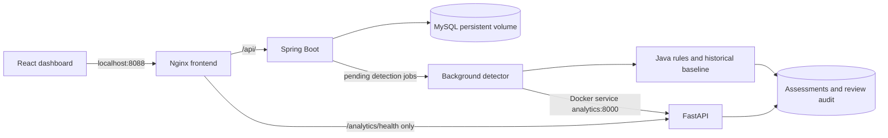

# FinGuard — Financial Transaction Anomaly Detection

A full-stack transaction monitoring workspace built with Java, Python and React.
FinGuard posts a consistent financial ledger, detects unusual activity with explainable
rules and Isolation Forest, and gives analysts an evidence-based investigation workflow.

**Milestone 5:** local container orchestration, safe demo initialization, smoke tests,
and portfolio documentation. No public deployment or cloud resources are configured.


## What it does

- Manage customers and accounts; post credits/debits and inspect paginated history.
- Keep balances exact with `BigDecimal` / `DECIMAL(19,2)`, transactions and row locks.
- Flag large amounts, bursts, possible duplicates and customer spending deviations.
- Combine rules with a Python Isolation Forest service, retaining rules during outages.
- Store detection evidence, model version, risk score, status and analyst review history.
- Monitor activity, volume and risk distribution in a responsive navy/white dashboard.
- Run locally using Compose with persistent MySQL data and file-mounted credentials.

Scores prioritize investigation on a 0–100 scale. **They are not calibrated fraud
probabilities.** Alerts do not automatically block or reverse valid transactions.

## Technology

| Layer | Stack |
| --- | --- |
| Ledger/API | Java 21, Spring Boot, Spring Data JPA, Bean Validation |
| Persistence | MySQL 8.4, Flyway migrations, exact decimal money |
| Analytics | Python 3.14, FastAPI, Pandas, NumPy, Scikit-learn Isolation Forest |
| Dashboard | React, Vite, JavaScript, Tailwind CSS, Recharts, Lucide |
| Local packaging | Multi-stage Docker builds, Nginx reverse proxy, Docker Compose |
| Verification | JUnit/Spring tests, pytest, Vitest/Testing Library, Playwright, smoke checks |

## Run the complete local stack

Prerequisites: Docker Engine/Desktop with Compose v2 (Linux containers), plus Python
3.10+ for the small environment-setup helper. Python 3.14 is used for native ML work.
Allow several minutes for the first image build: dependencies, Java/frontend tests,
Python tests and reproducible model training happen inside the build stages.

```powershell
git clone https://github.com/rohanshettym1-cmd/FinGuard-Financial-Anomaly-Detection.git
cd FinGuard-Financial-Anomaly-Detection
python scripts/setup_env.py --demo
docker compose config --quiet
docker compose up --build -d --wait --wait-timeout 240
```

Open **[http://localhost:8088](http://localhost:8088)**. Change `WEB_PORT` in the ignored
root `.env` if needed. Only the frontend is published, bound to loopback; MySQL,
Spring Boot and FastAPI communicate through Docker's private service network.

`setup_env.py` copies `.env.example` into an ignored `.env` and generates two random
password files in ignored `.secrets/`. It never prints passwords or overwrites an
existing environment/secret. Compose mounts the application password into MySQL and
Spring's config tree; the root password goes only to MySQL. There are no password
build arguments or browser secrets. Local Compose secrets are file mounts, not an
encrypted external secret manager; protect those files on your machine.

`--demo` opts in to 3 fictitious customers, 4 accounts and 27 postings on an empty
database. Demo creation uses the normal transaction services. A database seed marker
and its entire dataset commit together: restarts skip completed seeds, failures roll
back, and an existing nonempty customer database is left unchanged. To start empty,
omit `--demo`; to disable future initialization, set `DEMO_ENABLED=false` in `.env`.
These examples are deliberately dense synthetic activity, not representative fraud.

**Docker verification limitation:** Docker is not installed in the authoring environment.
Compose schema/static checks passed, but image builds and Compose execution have not
been verified there. The production frontend, adapted native Nginx proxy, MySQL,
Spring config-tree secrets, FastAPI and smoke checks were verified natively. Those
checks do not establish Linux container or Docker networking correctness. See the
[verification matrix and runbook](docs/local-stack.md).

## Architecture



Posting commits the balance, ledger entry and pending job in one database transaction.
Background detection runs separately and never edits balances. ML failure produces
an explicit rule-only assessment; database/worker failures leave a pending job for
retry. Historical features exclude the current/future transaction and other customers.

The browser uses relative `/api`; Nginx forwards it to `backend:8080`, while Java calls
`analytics:8000`. Browsers never need to resolve Docker-only service names. MySQL is
health-gated before backend startup; ML health does not block ledger availability.
The frontend starts after backend health. Health checks distinguish web serving,
backend process health and model readiness; they do not replace full smoke tests.

## Lifecycle and smoke tests

```powershell
# Status and logs
docker compose ps
docker compose logs --tail=100 backend analytics

# Read-only health/dashboard checks
python scripts/smoke.py

# Full synthetic write checks: local/disposable database only
python scripts/smoke.py --allow-writes
# Or run the same tool inside the Compose network, without host Python:
docker compose --profile tools run --rm smoke

# Stop/start without deleting data
docker compose stop
docker compose start

# Rebuild after source or base-image updates
docker compose build --pull
docker compose up -d --wait --wait-timeout 240

# Remove containers/network; retain MySQL data and local secrets
docker compose down
```

Smoke writes create a new synthetic customer/account, credit 12000.00, debit 125.50,
reject an overdraft, verify 11874.50 balance/two ledger records, poll detection, inspect
the explained alert, and save/read an analyst review. They never automatically retry
POST requests. A lost response may mean the operation committed; inspect history first.
Read-only smoke checks are the default. See the runbook for intentional ML outage tests.

**Destructive reset — disposable demo data only:** the following removes the project's
MySQL volume, including every ledger entry and review. It is not part of normal stop
or rebuild. No reset was executed against an existing user database during this work.

```powershell
docker compose down --volumes
docker compose up --build -d --wait --wait-timeout 240
```

Keep `.env` and `.secrets/` when resetting. Replacing a password file alone does not
rotate credentials inside an already initialized MySQL volume.

## API examples

Base URL through the local reverse proxy: `http://localhost:8088/api`.
Use Postman raw JSON or your HTTP client; substitute IDs returned by earlier calls.

| Method | Path | Purpose |
| --- | --- | --- |
| GET | `/health` | Backend process health |
| POST / GET | `/customers` | Create/list customers |
| GET | `/customers/{id}` | Customer details |
| POST | `/accounts` | Create zero-balance account |
| GET | `/accounts?customerId={id}` | Customer accounts |
| GET | `/accounts/{id}/balance` | Exact current balance |
| POST | `/transactions` | Credit/debit posting |
| GET | `/transactions?accountId={id}&page=0&size=20` | Paginated account ledger |
| GET | `/transactions/{id}/risk` | 202 pending, then completed assessment |
| GET | `/alerts?status=OPEN&page=0&size=20` | Flagged investigation queue |
| POST / GET | `/alerts/{id}/reviews` | Append/read review audit trail |

```json
{"name":"Demo Customer","email":"demo-api@example.test"}
```

```json
{"customerId":1,"status":"ACTIVE"}
```

```json
{"accountId":1,"type":"CREDIT","amount":"12000.00","description":"Synthetic deposit"}
```

```json
{"status":"IN_REVIEW","analyst":"Demo Analyst","notes":"Reviewing synthetic evidence"}
```

Use the [existing Postman collection](docs/FinGuard.postman_collection.json),
[detailed native/API guide](docs/native-setup.md), and [frontend guide](frontend/README.md)
for additional endpoints, validation, local Vite configuration and examples.

## Model evaluation

Chronological held-out synthetic evaluation, seed 42: 5,701 events; 4,275 training /
1,426 test events, including 146 injected positives. Model weights, rank reference
and threshold use training data only. Earlier test events may update later historical
features as in online scoring; labels never enter model fitting.

| Detector | Precision | Recall | F1 | False-positive rate |
| --- | --- | --- | --- | --- |
| Isolation Forest | 87.67% | 43.84% | 58.45% | 0.70% |
| Rules | 100.00% | 67.12% | 80.33% | 0.00% |
| Hybrid | 91.74% | 68.49% | 78.43% | 0.70% |

The hybrid caught two additional synthetic positives but added nine false positives,
so its F1 was lower than rules alone. Synthetic injections deliberately resemble
some rules; these numbers do not establish real financial fraud performance.
See [exact metrics/provenance](docs/evaluation.json) and [ML design/limitations](docs/anomaly-detection.md).

## Verification and portfolio notes

```powershell
cd backend
.\mvnw.cmd clean verify
cd ../ml-service
python -m pytest -q
cd ../frontend
npm ci
npm test
npm run build
cd ..
python -m unittest discover -s scripts/tests -v
```

For the opt-in disposable MySQL suite and full-stack Playwright tests, follow the
[native guide](docs/native-setup.md) and [frontend testing guide](frontend/README.md).
Container builds run the existing language-specific tests before copying runtime
artifacts. Runtime images omit Maven, Node build tooling, Python test tooling and
training CSVs. Java, Python and Nginx runtime processes are non-root, with read-only
filesystems, temporary writable scratch space and dropped capabilities in Compose.

The current native verification results and the explicit Docker limitation are in
[docs/local-stack.md](docs/local-stack.md). CI configuration has not been added: the
configured GitHub token previously lacked workflow scope. All checks are locally runnable.

## Scope and limitations

- This is a local educational/portfolio application, not a production banking system.
- Authentication, ownership authorization, verified analyst roles, TLS, idempotency
  keys, transfers and reversal workflows remain future work. CORS is not authentication.
- Review status and ML scores do not prove fraud or automatically move/reverse money.
- The dashboard aggregates complete API pages into a refreshable non-atomic snapshot;
  very large portfolios need server-side reporting endpoints and incremental features.
- Base images use maintained version-line tags, not immutable digests. Pull, scan and
  review updates before any production release. No public release has been performed.
- Database files, passwords, `.env`, models, raw datasets, build outputs and test traces
  stay out of Git. Screenshots contain fictitious synthetic data only.

## Repository map

| Path | Purpose |
| --- | --- |
| `backend/` | Java API, ledger, detection worker, migrations, opt-in demo seeder |
| `ml-service/` | FastAPI, causal feature engineering, training/evaluation and tests |
| `frontend/` | Dashboard, Nginx config, component and browser tests |
| `database/` | Human-readable schema reference and small manual synthetic fixture |
| `scripts/` | Safe local configuration, smoke checks and static Compose validation |
| `docs/` | Runbooks, screenshots, architecture and interview talking points |

[Project explanation and interview talking points](docs/portfolio.md) ·
[Mobile screenshot](docs/screenshots/overview-mobile.png) ·
[Analyst investigation screenshot](docs/screenshots/investigation.png)

## Milestone 6: investigated alert sensitivity

The 35/36 demo alert count reflects both intentionally suspicious rapid seed data
and a narrow original ML training distribution. The updated model uses broader
synthetic normal contexts and chronological train/validation/test threshold selection.
On the same new held-out test, hybrid precision/recall/F1/FPR changed from
20.12%/83.74%/32.44%/34.00% (frozen legacy model) to
88.89%/78.05%/83.12%/1.00%. This sacrifices recall; ML added no detections beyond
rules on this test. These are synthetic evaluation results, not real fraud claims.

See [investigation, reproducible commands and limitations](docs/ml-optimization.md)
and [exact new evaluation](docs/evaluation-m6.json). The table above is the preserved
Milestone 3 benchmark on its original dataset, not the new model's evaluation.
Historical alerts/reviews remain unchanged; the dashboard's historical alert rate
will therefore not reset when the model changes. Risk scores are not probabilities.
