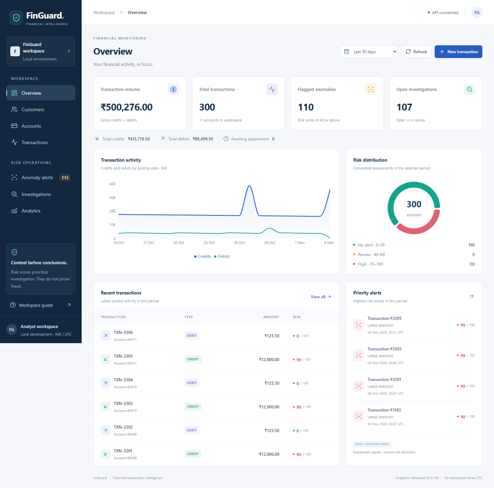
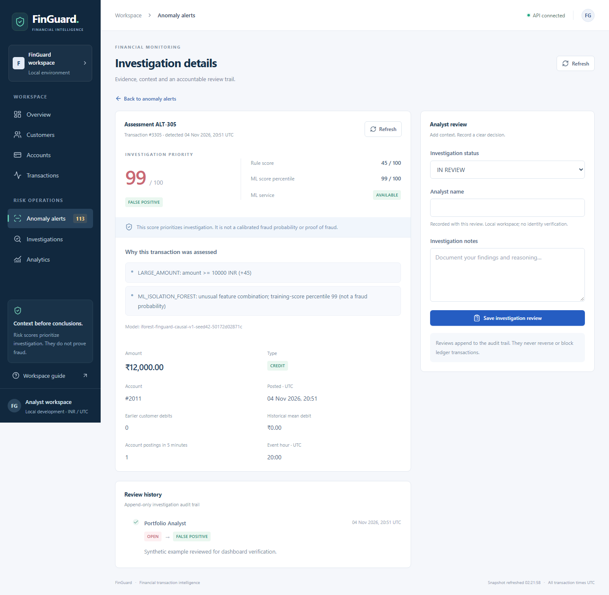

# FinGuard — Financial Transaction Anomaly Detection

FinGuard combines a Java financial ledger with rules and a Python Isolation Forest service.
**Milestone 4 adds a responsive React monitoring dashboard integrated with the existing APIs.**
All Milestone 1–3 functionality remains available. Deployment has not started.

## Monorepo

| Directory | Responsibility |
| --- | --- |
| `backend/` | Java 21, Spring Boot, Spring Data JPA, Flyway, MySQL |
| `database/` | Reviewed schema reference and synthetic sample data |
| `docs/` | Design notes and importable Postman collection |
| `frontend/` | React, Vite, Tailwind CSS, Recharts, Lucide icons and browser tests |
| `ml-service/` | FastAPI, Pandas, NumPy, Scikit-learn, reproducible training and evaluation |

## Prerequisites and tests

Install JDK 21, set `JAVA_HOME`, and put Java on `PATH`. Git and internet access are
needed for the first build. The Maven wrapper downloads Maven automatically.
MySQL 8.4 is required to run the normal application. Tests use isolated in-memory
H2 in MySQL compatibility mode by default, requiring no database installation:

```powershell
cd backend
.\mvnw.cmd clean verify
```

On macOS/Linux use `./mvnw clean verify`. The build runs the original real-HTTP
health tests plus full-stack financial API tests using controllers, services, JPA,
and the real Flyway migration. Coverage includes exact decimals, validation,
insufficient funds, inactive accounts, pagination, failed-insert rollback,
rollback of already-flushed writes, concurrent credits, and competing debits.
H2 is a test-only dependency and is not included in the packaged application.

To run the same suite against MySQL, create a **separate empty disposable database**
such as `finguard_test` and a user restricted to that database. Tests insert synthetic
data and leave it there; never point them at an existing or production database.

```powershell
$env:TEST_DB_URL = 'jdbc:mysql://localhost:3306/finguard_test?connectionTimeZone=UTC'
$env:TEST_DB_USERNAME = 'your_test_user'
# Set TEST_DB_PASSWORD securely in your environment, then:
.\mvnw.cmd '-Dtest.database=mysql-test' clean verify
```

On macOS/Linux export the same variables and use `./mvnw -Dtest.database=mysql-test clean verify`.
The MySQL test profile requires `TEST_DB_*`; it never falls back to normal `DB_*`.

## MySQL setup

As a local MySQL administrator, create a database and user. Replace the credential
placeholder privately; do not save a real password in repository files or shell history.

```sql
CREATE DATABASE finguard CHARACTER SET utf8mb4 COLLATE utf8mb4_unicode_ci;
CREATE USER 'finguard_app'@'localhost' IDENTIFIED BY '<choose-a-local-password>';
GRANT SELECT, INSERT, UPDATE, DELETE, CREATE, ALTER, INDEX, REFERENCES
    ON finguard.* TO 'finguard_app'@'localhost';
```

Startup runs Flyway's V1 and V2 migrations and validates the JPA mappings. Existing
Milestone 2 databases receive V2 without editing V1 or changing balances. V2 queues
existing transactions for detection. Do not manually execute `database/schema.sql`
before starting: it mirrors V1+V2 and would conflict with Flyway's history. For later schema changes,
add a new migration; do not modify an applied one. DDL privileges are for local
migration development; production can use a separate migration identity.

## Configure and start

`backend/.env.example` lists the supported variables. Spring Boot reads exported
environment variables; it does **not** automatically load `.env` files.

| Variable | Default | Purpose |
| --- | --- | --- |
| `SERVER_PORT` | `8080` | HTTP port |
| `DB_URL` | `jdbc:mysql://localhost:3306/finguard?connectionTimeZone=UTC` | Database connection |
| `DB_USERNAME` | required | Local application database user |
| `DB_PASSWORD` | required | Database password; never commit it |

From `backend/` in PowerShell:

```powershell
$env:DB_URL = 'jdbc:mysql://localhost:3306/finguard?connectionTimeZone=UTC'
$env:DB_USERNAME = 'finguard_app'
$localCredential = Read-Host 'MySQL password' -AsSecureString
$env:DB_PASSWORD = [System.Net.NetworkCredential]::new('', $localCredential).Password
.\mvnw.cmd spring-boot:run
```

Alternatively after building: `java -jar target/finguard-backend-0.0.1-SNAPSHOT.jar`.
For another HTTP port set `$env:SERVER_PORT = '8081'` first. Stop with Ctrl+C.
On macOS/Linux export `DB_URL`, `DB_USERNAME`, and `DB_PASSWORD` securely and run
`./mvnw spring-boot:run`. MySQL must be reachable for application startup. The health
endpoint remains a process health check, not a live database-readiness check:

```json
{"status":"UP","service":"finguard-backend"}
```

For optional synthetic fixtures, start the app once to migrate an empty database,
then run this from the repository root using the MySQL CLI (it prompts for a password):

```text
mysql -u finguard_app -p finguard
source database/sample-data.sql
```

Run the sample once on an otherwise empty local database. It creates two fictitious
customers, three accounts (one inactive), and a credit/debit history matching a
1000.00 balance on account 2001. It is not loaded automatically.

## REST endpoints

Base URL: `http://localhost:8080`. POST endpoints return 201 with a `Location` header.
GET endpoints return 200. Amounts are INR, exact decimals with up to two decimal
places. Accounts start at zero. Timestamps are UTC. CREDIT adds funds; DEBIT removes
funds. Status defaults to ACTIVE, or explicitly specify INACTIVE when creating.

| Method | Path | Purpose |
| --- | --- | --- |
| GET | `/api/health` | Existing process health |
| POST | `/api/customers` | Create customer (unique email, normalized lowercase) |
| GET | `/api/customers/{id}` | Get customer |
| GET | `/api/customers` | List customers by ID ascending |
| POST | `/api/accounts` | Create zero-balance account for a customer |
| GET | `/api/accounts/{id}` | Get account |
| GET | `/api/accounts?customerId=1` | List a customer's accounts |
| GET | `/api/accounts/{id}/balance` | Get current balance |
| POST | `/api/transactions` | Post credit or debit atomically |
| GET | `/api/transactions/{id}` | Get transaction, including balance after posting |
| GET | `/api/transactions?accountId=1&page=0&size=20` | List account history |

Transaction pages contain `content`, `page`, `size`, `totalElements`, and `totalPages`.
Pages are zero-based, size is 1–100, and order is descending transaction ID. Missing
parents return 404; an existing parent with no children returns an empty result.
IDs must be positive integers. Enums must be named strings, not numeric ordinals.
Invalid bodies, amounts, pagination, inactive-account postings, overdrafts, and
balance overflow return 400. Duplicate email/database conflicts and lock conflicts
return 409. Validation errors use `code`, `message`, and `fields`, for example:

```json
{"code":"INSUFFICIENT_FUNDS","message":"Account has insufficient funds","fields":{}}
```

## Postman examples

Import `docs/FinGuard.postman_collection.json` and run its requests in order. It
captures generated IDs as collection variables. The default `baseUrl` is localhost.
Alternatively create these POST requests with **Body → raw → JSON** and
`Content-Type: application/json`, substituting the IDs returned by earlier responses:

Create customer, `POST /api/customers`:

```json
{"name":"Demo Asha","email":"asha-api@example.test"}
```

Create account, `POST /api/accounts`:

```json
{"customerId":1,"status":"ACTIVE"}
```

Credit, `POST /api/transactions`:

```json
{"accountId":1,"type":"CREDIT","amount":1000.00,"description":"Synthetic deposit"}
```

Debit, `POST /api/transactions`:

```json
{"accountId":1,"type":"DEBIT","amount":125.50,"description":"Synthetic purchase"}
```

Then GET `/api/accounts/1/balance` (874.50) and GET
`/api/transactions?accountId=1&page=0&size=10`. A debit of 9999.00 should return
400 without changing the balance or adding a transaction.

## Key concepts and workflow

Controllers validate requests; DTOs define input/output contracts; services enforce
business rules; repositories load and save JPA entities. An account-row write lock
and `@Transactional` keep balance updates and ledger inserts atomic even with
concurrent requests. See `docs/README.md` for relationships, rollback, and migration
details. The current API is for local development: authentication and idempotent
posting are not implemented. Inspect history before retrying a POST with a lost response.

For each approved milestone: build → test → review diff/secrets → commit → push to
`main`. Never force-push, rewrite history, overwrite unrelated work, or commit real
credentials, `.env` files, dumps, or build outputs. Only reviewed migrations and
the named synthetic SQL fixtures are exceptions to the SQL ignore rule. Start the
next milestone only after approval.

## Milestone 3: hybrid anomaly detection

Train and start the Python service in a second terminal (verified with Python 3.14):

```powershell
cd ml-service
python -m venv .venv
.\.venv\Scripts\python.exe -m pip install -r requirements.txt
.\.venv\Scripts\python.exe -m pytest -q
.\.venv\Scripts\python.exe -m analytics.train --seed 42 --output artifacts
.\.venv\Scripts\python.exe -m uvicorn analytics.app:app --host 127.0.0.1 --port 8000
```

On macOS/Linux use `.venv/bin/python`. Training generates ignored synthetic CSV,
model and evaluation artifacts; no customer data is needed. `GET http://localhost:8000/health`
returns 200 when ready (503 if the model is absent/incompatible). Set `MODEL_PATH`
to override the default `artifacts/isolation_forest.joblib`. Load only trusted local
joblib files; never load uploaded/untrusted serialized models.

Start Java using the existing MySQL setup. V2 migrates existing databases and queues
older transactions automatically. New postings commit balances, ledger entries and
a pending detection job together. Background detection runs in a separate transaction;
Python timeouts or outages never undo a valid posting. Assessments may appear a few
seconds later; poll the risk endpoint rather than expecting them in the POST response.

| Java environment variable | Default | Purpose |
| --- | --- | --- |
| `DETECTION_ENABLED` | `true` | Enable background queue processing |
| `DETECTION_POLL_DELAY_MS` | `2000` | Delay between batches of up to 20 pending jobs |
| `ML_ENABLED` | `true` | Enable Python inference; false uses rules only |
| `ML_BASE_URL` | `http://localhost:8000` | Python service URL |
| `ML_CONNECT_TIMEOUT_MS` | `300` | Connection timeout (1–10000 ms) |
| `ML_REQUEST_TIMEOUT_MS` | `1000` | Overall HTTP request timeout (1–10000 ms) |

Unreachable Python, HTTP failures, invalid responses and timeouts retain all rules
and record `mlStatus=UNAVAILABLE`. `ML_ENABLED=false` records `DISABLED`. Rule-only
assessments complete normally; they are not automatically re-scored after recovery.
Database/worker failures leave jobs pending for retry. Failed or rolled-back ledger
postings leave no detection job. Both H2/MySQL test profiles disable the scheduler
and call detection explicitly, avoiding timing-dependent tests and external ML calls.

| Method | Endpoint | Result |
| --- | --- | --- |
| GET | `/api/transactions/{id}/risk` | 202 PENDING until assessed; then 200 with scores/reasons |
| GET | `/api/alerts?page=0&size=20&status=OPEN` | Flagged assessments, newest first; status optional |
| GET | `/api/alerts?includeNormal=true` | Also include normal assessments |
| GET | `/api/alerts/{id}` | Assessment features, scores, ML status, model version and reasons |
| POST | `/api/alerts/{id}/reviews` | Append analyst review and update status (201) |
| GET | `/api/alerts/{id}/reviews` | Chronological review audit trail |
| GET | Python `/health` | Model readiness |
| POST | Python `/predict` | Validated feature inference; 422 invalid input, 503 model unavailable |

Reviewable statuses are OPEN, IN_REVIEW, CONFIRMED and FALSE_POSITIVE. Normal
assessments use NOT_REQUIRED and cannot be reviewed. Alert pages are zero-based,
size 1–100, page 0–1,000,000. Review notes and analyst are required, with maximum
lengths 1000 and 100 respectively. These local-development APIs do not authenticate
analysts or automatically block/reverse transactions.

Example: post a valid credit of 15000.00 using the existing API, capture its ID,
then GET `/api/transactions/{id}/risk`. The LARGE_AMOUNT rule contributes 45 points.
Possible duplicates and rapid postings add explanations; historical customer debit
baselines require at least 5 earlier debits. Review a flagged assessment in Postman:

```http
POST /api/alerts/1/reviews
Content-Type: application/json
```

```json
{"status":"IN_REVIEW","analyst":"Demo Analyst","notes":"Investigating synthetic activity"}
```

Python prediction example (raw JSON POST to `http://localhost:8000/predict`):

```json
{"amount":"15000.00","hour":2,"frequency_5m":6,"prior_debit_count":20,"baseline_mean":"300.00","is_debit":true}
```

Rule points add and cap at 100. An ML outlier contributes `max(40, mlScore)`;
hybrid risk is the maximum of that contribution and the rule score. Scores at least
40 are flagged. Python's score is a training-anomaly-score percentile, not a
calibrated fraud probability. See [design and rule definitions](docs/anomaly-detection.md)
for thresholds, historical cutoffs, clock features, cold starts and SQL concepts.

Actual reproducible evaluation (seed 42): 5,701 synthetic events, chronological
split of 4,275 training / 1,426 test events, including 146 labeled test injections.
Labels never enter model fitting; thresholds and ranking reference use training
only. Earlier test events update later baselines causally; model weights stay frozen.

| Detector | Precision | Recall | F1 | False-positive rate |
| --- | --- | --- | --- | --- |
| Isolation Forest | 87.67% | 43.84% | 58.45% | 0.70% |
| Rules | 100.00% | 67.12% | 80.33% | 0.00% |
| Hybrid | 91.74% | 68.49% | 78.43% | 0.70% |

The hybrid caught two more synthetic positives than rules but added nine false
positives, reducing F1. Synthetic patterns intentionally resemble the rules and do
not establish real fraud-detection performance. The data lacks real-world prevalence,
drift and adjudicated fraud labels. The 0–100 scores prioritize investigation; they
are not probabilities or proof of fraud. Exact confusion counts, model version,
dataset hash and limitations are in [evaluation.json](docs/evaluation.json).

Run Java `clean verify` using the existing H2 and opt-in disposable MySQL commands
above, and run Python `python -m pytest -q` from `ml-service`. Java tests cover normal,
large, duplicate, burst and baseline rules; ML HTTP errors/timeouts/invalid responses;
job rollback/retry; durable alerts and analyst reviews; and all prior ledger/health
cases. Python tests cover reproducibility, chronological splits, historical-only
features, serving parity, validation and unavailable/corrupt model behavior.

## Milestone 4: React monitoring dashboard

Start MySQL/Python/Spring Boot as above, then open another terminal:

```powershell
cd frontend
npm ci
Copy-Item .env.example .env.local
npm run dev
```

Use Node 22.12+ (verified on 22.18). Open `http://127.0.0.1:5173`. On macOS/Linux
use `cp .env.example .env.local`. The default public configuration is
`VITE_API_BASE_URL=http://localhost:8080/api`; restart Vite after changing it.
Never put database credentials, tokens or secrets in any `VITE_*` variable.

The navy/white dashboard includes overview KPIs, Recharts trends/volume/risk charts,
customer creation/details, account creation/balances, credit/debit posting, paginated
and filtered transaction history, anomaly explanations and persisted analyst review
history. Every production figure comes from Spring Boot. No browser connection to
MySQL or Python is needed. ML outages retain the backend's existing rule-only fallback.

The frontend uses existing routes only: customers, accounts by customer, paginated
transactions by account, assessments/alerts, risk status and review history. Because
there is no global aggregate endpoint, it loads complete API pages with bounded
concurrency and computes a refreshable client snapshot. Dates use UTC; period
filters are based on posting time. Monetary totals use lossless JSON parsing and
`decimal.js`; chart scales are approximate visualizations. Gross volume means
credits plus debits. Pending assessments are never counted as low-risk results.
This approach suits a portfolio/local workspace; large datasets need future backend
reporting endpoints. See [frontend architecture and setup](frontend/README.md).

Backend CORS defaults to the exact origins `http://localhost:5173` and
`http://127.0.0.1:5173`, without browser credentials or wildcards. Configure
`FRONTEND_ALLOWED_ORIGINS` as comma-separated exact origins if needed. CORS does not
replace authentication. Analyst names remain self-declared; no deployment or
production identity/security work is included in this milestone.

```powershell
cd frontend
npm test
npm run build
```

The production build writes ignored `frontend/dist/`. Optional `npm run preview`
uses port 4173; explicitly allow `http://127.0.0.1:4173` in backend CORS for that
local verification. No deployment is performed. Full-stack Playwright checks are
opt-in and write synthetic records; follow the isolated-database instructions in
[frontend/README.md](frontend/README.md) before running `npm run test:e2e`.

Validation completed for this milestone: 25 frontend unit/integration tests,
4 full-stack browser tests, 51 Java tests on both H2 and disposable MySQL, and
20 Python tests. Browser checks exercise actual CORS and APIs, customer/account
creation, credit/debit posting, insufficient-funds rejection, persisted analyst
review after reload, loading/error recovery, keyboard focus, and mobile layout.
No private customer data was used in browser testing or screenshots.

Desktop overview, captured from a disposable synthetic-data database:



Analyst investigation with stored evidence and an appended synthetic review:



[View the mobile overview screenshot](docs/screenshots/overview-mobile.png).
The screenshots are illustrative synthetic snapshots; production screens contain
no hardcoded demo data. Test logs, browser traces, generated models/datasets,
credentials, dependencies and build artifacts stay out of Git.
