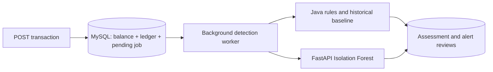

# Milestone 3: hybrid anomaly detection

## Architecture and transaction safety

A database transaction is an all-or-nothing unit of work. Posting writes the balance,
ledger entry, and a durable `detection_jobs` row in the same transaction. No network
call or rule evaluation happens there. A background worker polls up to 20 pending
jobs per cycle and processes each using a separate `REQUIRES_NEW` transaction.
It locks the job row, computes rules, optionally calls Python, saves the assessment,
and marks the job complete atomically. Duplicate worker attempts are serialized by
the lock; completed jobs are skipped. A crashed/failed database operation leaves the
job pending for retry. Detection never changes an account balance.

Timeouts, HTTP failures, missing models, invalid JSON and invalid ML scores produce
rule-only assessments with `mlStatus=UNAVAILABLE`. Disabled ML reports `DISABLED`.
These jobs complete normally; restoring ML affects new jobs, not already completed
rule-only assessments. There is no automatic re-scoring of historical assessments.
The alert stores the features, model version, scores and reasons used at detection
time so later analyst review does not silently change its evidence.

This is a small teaching implementation: history queries load the customer's prior
rows, and inference happens while holding a job lock, not an account balance lock.
At production scale use incremental historical aggregates, bounded worker pools,
monitoring/dead-letter handling, and stronger operational controls. Retrying failed
jobs is not a promise of immediate processing; clients poll the risk endpoint.

## Rules and scores

| Signal | Definition | Points |
| --- | --- | --- |
| LARGE_AMOUNT | Credit or debit at least 10,000 INR | 45 |
| RAPID_FREQUENCY | At least 5 postings to the same account in the inclusive last 5 minutes, including the current posting | 40 |
| POSSIBLE_DUPLICATE | Earlier same-account, same-type, same-amount posting in the inclusive last 60 seconds | 45 |
| CUSTOMER_BASELINE | Debit at least 1,000 INR and at least 3 times the mean of at least 5 earlier customer debits across accounts | 40 |

Rule points add up and are capped at 100. The historical baseline excludes credits,
the current transaction, other customers, later IDs and timestamps after the target.
With fewer than 5 earlier debits the baseline rule is inactive; no fabricated
customer baseline is substituted. Frequency is account-specific; spending baseline
is customer-specific. Possible duplicates are investigation signals, not blocked or
automatically reversed transactions. All valid ledger operations still post.

Python returns an empirical percentile (0–100) of the event's Isolation Forest
anomaly score relative to training scores, plus a separate `anomalous` flag using
the frozen training threshold. Percentile is a rank, **not a fraud probability**.
Hybrid risk is `max(ruleScore, max(40, mlScore) if anomalous else 0)`. This cannot
lower a rule-based score. Scores at least 40 open an alert; other assessments use
`NOT_REQUIRED` and are hidden from the default alert list. Reasons explain rule
thresholds and historical values. The ML reason describes unusual feature combinations;
it is not a causal feature attribution or proof of fraud.

## Features and leakage prevention

Java sends only aggregated numeric features, not names, emails or review notes:
`amount`, `hour` (UTC), `frequency_5m`, `prior_debit_count`, `baseline_mean`, `is_debit`.
Pandas builds a chronological table. Feature engineering reads each row's earlier
history, emits its features, then updates the history. The offline implementation
and serving endpoint share the same feature transformation. NumPy produces:

- `log(1 + amount)` to reduce the effect of large numeric magnitudes.
- Sine/cosine of UTC hour, so 23:00 and 00:00 remain close on a clock.
- `log(1 + frequency)` for recent account activity.
- `log(1 + amount / historical_mean)` for debits with at least 5 previous debits;
  the ratio is neutral (1) otherwise, including credits.
- A debit indicator (0 or 1).

Money in the ledger remains `BigDecimal`/`DECIMAL`; model features use floating-point
arrays for numerical analysis and are never written back as balances.

The reproducible generator (seed 42) creates 90 days for 30 fictitious customers.
Labels indicate injected large-amount, burst, duplicate, or unusual-hour patterns;
they are never passed to `fit()` or used to choose the threshold. Events are sorted
by timestamp and ID. Training uses the first approximately 75%, and testing the
later 25%, with a strict timestamp boundary. Isolation Forest uses 200 trees,
`random_state=42`, `n_jobs=1`, and preset contamination 0.05. Its threshold and rank
reference are fitted using training data only. Earlier held-out events can update
later held-out customer history as in an online system; model weights stay frozen.
There is no shuffling, global spending mean, or test-label threshold tuning.

## Actual held-out evaluation

See [evaluation.json](evaluation.json) for exact counts, dataset hash, model version,
dependency version, split boundary and unrounded results. The committed file is a
small evaluation summary, not customer data or a trained model.

5,701 total events; 4,275 training, 1,426 testing. The test set contains 146 injected
positives and 1,280 negatives. The boundary is 2026-03-09 16:59:47 UTC.

| Detector | Precision | Recall | F1 | False-positive rate |
| --- | --- | --- | --- | --- |
| Isolation Forest | 87.67% | 43.84% | 58.45% | 0.70% |
| Rules | 100.00% | 67.12% | 80.33% | 0.00% |
| Hybrid | 91.74% | 68.49% | 78.43% | 0.70% |

Precision = TP/(TP+FP), recall = TP/(TP+FN), F1 is their harmonic mean, and
false-positive rate = FP/(FP+TN). Hybrid counts: TP 100, FP 9, TN 1,271, FN 46.
The hybrid catches two more labeled cases than rules but adds nine false positives,
so its F1 is lower on this dataset. This is not evidence that the hybrid is always
better. Rules' perfect synthetic precision reflects the intentionally injected
patterns and clean benign generator; it will not transfer to real financial data.
The fixed generator, anomaly prevalence, missing real-world drift and lack of real
fraud labels limit all results. Analyst confirmations are stored for investigation,
not automatically treated as training labels. Real deployment needs separate
representative data, validation, threshold selection and monitoring.

Sources: [Isolation Forest API](https://scikit-learn.org/stable/modules/generated/sklearn.ensemble.IsolationForest.html),
[Spring transaction propagation](https://docs.spring.io/spring-framework/reference/data-access/transaction/declarative/tx-propagation.html),
[FastAPI tests](https://fastapi.tiangolo.com/tutorial/testing/).

## SQL, investigations, and API behavior

V2 adds job, assessment and review tables, foreign keys, uniqueness and score-range
checks. One assessment is stored per transaction, including normal/rule-only cases.
V2 backfills jobs for older ledger entries. Do not modify V1 on an existing database.
Review requests append an audit row recording old/new status, analyst, notes and UTC
time, while locking/updating the alert status in the same transaction. Flagged alerts
can be moved among OPEN, IN_REVIEW, CONFIRMED and FALSE_POSITIVE (including reopening).
Normal assessments cannot be reviewed as alerts. All scores and evidence are retained.

Analyst names are self-declared in this local-development API. Authentication,
ownership authorization, idempotency keys, review role enforcement and regulatory
fraud decisions remain outside this milestone. Neither alerts nor confirmations
automatically block, reverse or change transactions. No React work is included.
